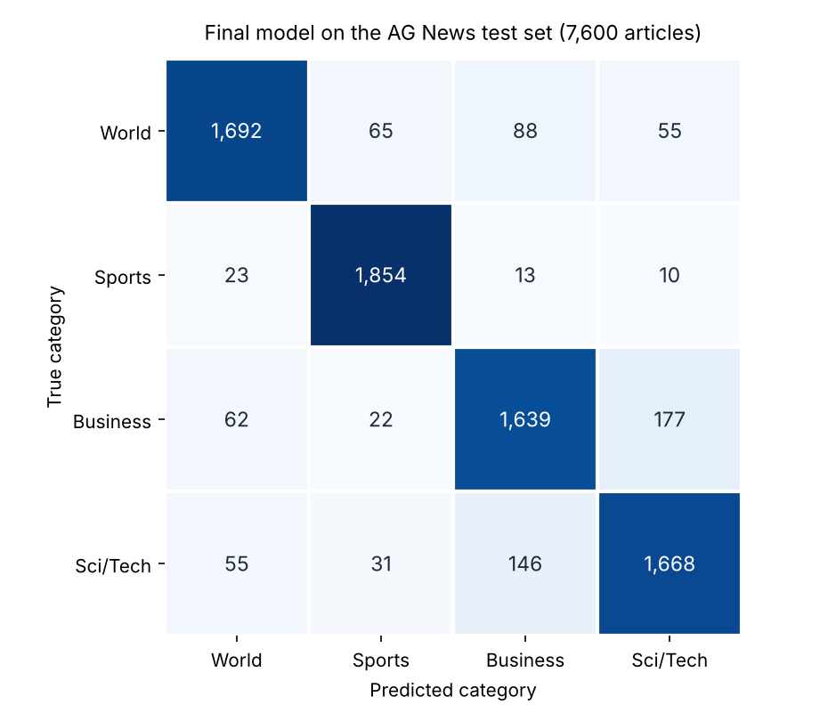

# Intelligent News Classifier

[](https://intelligent-news-classifier-dhecwgfu4rg3utdnrc5xn9.streamlit.app/)


A text-classification pipeline that sorts news articles into four categories (**World, Sports, Business, Sci/Tech**) and serves the best model in a Streamlit web app. Trained on 120,000 AG News articles, the final model reaches **90.17% accuracy and 0.901 macro-F1** on the 7,600-article held-out test set.

**[Try the live demo →](https://intelligent-news-classifier-dhecwgfu4rg3utdnrc5xn9.streamlit.app/)** Paste a headline or short article, or pick an example, and the app returns its category.

Team project · Lambton College AI & ML program · January – April 2026 · 4 members (see [Team](#team))

---

## Results

The final model is a TF-IDF (unigrams + bigrams, 5,000 features) + LinearSVC pipeline with `C = 0.5`, chosen on a validation split and then retrained on all 120,000 training articles.

| Category | Precision | Recall | F1 | Test articles |
| --- | --- | --- | --- | --- |
| World | 0.924 | 0.891 | 0.907 | 1,900 |
| Sports | 0.940 | 0.976 | 0.958 | 1,900 |
| Business | 0.869 | 0.863 | 0.866 | 1,900 |
| Sci/Tech | 0.873 | 0.878 | 0.876 | 1,900 |
| **Overall** | **0.902** | **0.902** | **0.901 (macro)** | **7,600** |



**Where it goes wrong:** Business and Sci/Tech are the hardest pair to separate, and those two confusions account for 323 of the 747 test errors (43%). Most are earnings, pricing and acquisition stories about tech companies (Intel, Amazon, Salesforce, Intuit), which mix both vocabularies. Some come from the labels themselves: the same Amazon–Joyo.com acquisition story appears in the test set under both Business and Sci/Tech. Sports is the easiest category (F1 0.958).

### Model comparison

| Model | Setting | Data used for scoring | Accuracy | Macro-F1 |
| --- | --- | --- | --- | --- |
| **LinearSVC (final)** | **C = 0.5, retrained on train + validation** | **Test set (7,600)** | **0.9017** | **0.9015** |
| Logistic Regression | default C = 1.0 | Test set | 0.8993 | 0.8991 |
| LinearSVC | default C = 1.0 | Test set | 0.8979 | 0.8976 |
| LinearSVC | C = 0.5 (best of 8 configs) | Validation split (24,000) | 0.9081 | 0.9079 |
| Logistic Regression | C = 1.0 (its best config) | Validation split | 0.9058 | 0.9055 |

Both models were tuned over `C ∈ {0.5, 1, 2, 4}` on a stratified 20% validation split. Smaller vocabularies (2,000–3,000 features) were also tested in later experiments and scored lower, so the 5,000-feature model was kept.

## How it works

```
AG News CSV ──► combine Title + Description ──► lowercase, normalise whitespace
     │
     ▼
stratified 80/20 train / validation split (seed 42)
     │
     ▼
TF-IDF (1–2-grams, 5,000 features) + Logistic Regression or LinearSVC
     │
     ▼
tune C on validation ──► retrain best on all 120,000 articles ──► evaluate on test set
     │
     ▼
models/best_model.pkl ──► Streamlit app (app/app.py)
```

1. **Data:** [`src/data_loader.py`](src/data_loader.py) reads the AG News CSVs, joins each article's title and description, and makes a stratified train/validation split. The four classes are perfectly balanced (30,000 training articles each).
2. **Preprocessing:** [`src/preprocess.py`](src/preprocess.py) lowercases text and normalises whitespace; the same function is used at training time and in the app.
3. **Training and tuning:** [`src/train.py`](src/train.py) builds the scikit-learn pipelines; [`src/tune.py`](src/tune.py) tunes both models, retrains the winner on all training data and saves it.
4. **Evaluation:** [`src/evaluate.py`](src/evaluate.py) writes accuracy, macro-F1, per-class metrics and confusion matrices to `reports/`; the `week*` scripts add misclassification reviews and error-pattern summaries.
5. **App:** [`app/app.py`](app/app.py) loads `models/best_model.pkl` and predicts the category of any text you enter.

**Labels** follow the AG News encoding everywhere (loader, training, evaluation, reports and app): `1 = World`, `2 = Sports`, `3 = Business`, `4 = Sci/Tech`.

## Run it locally

Uses Python 3.11 (the Codespaces version); newer versions such as 3.13 also work.

```bash
git clone https://github.com/Krushal16/Intelligent-News-Classifier.git
cd Intelligent-News-Classifier

python -m venv venv
source venv/bin/activate          # Windows PowerShell: .\venv\Scripts\activate
pip install -r requirements.txt

streamlit run app/app.py          # uses the trained model already in models/
```

On Windows, if PowerShell blocks the activation script, run `Set-ExecutionPolicy -ExecutionPolicy RemoteSigned -Scope CurrentUser` once first.

To retrain and re-evaluate everything from the raw data (takes a few minutes):

```bash
python run_pipeline.py            # trains, tunes, saves models/best_model.pkl and writes reports/
python -m src.tune                # tuning step only
```

Retraining can change the last decimal places of the metrics slightly, depending on your scikit-learn version.

**Or open it in GitHub Codespaces:** the included dev container installs the requirements and starts the Streamlit app automatically (Code → Codespaces → Create codespace).

## Project structure

```
Intelligent-News-Classifier/
├── app/
│   └── app.py                    # Streamlit web app
├── data/raw/                     # AG News train.csv (120,000) and test.csv (7,600)
├── docs/images/                  # README figures
├── models/
│   ├── best_model.pkl            # final TF-IDF + LinearSVC (C = 0.5)
│   ├── logreg_tfidf.pkl          # baseline Logistic Regression
│   └── svm_tfidf.pkl             # baseline LinearSVC
├── notebooks/
│   ├── 01_eda.ipynb              # dataset exploration
│   └── 03_baseline_train_eval.ipynb
├── reports/
│   ├── figures/                  # confusion matrices
│   └── metrics/                  # metrics, tuning results, misclassified samples
├── src/                          # data loading, preprocessing, training, tuning, evaluation
├── .devcontainer/                # GitHub Codespaces setup
├── requirements.txt
└── run_pipeline.py               # end-to-end pipeline
```

## Dataset

AG News (Zhang, Zhao & LeCun, 2015): news articles labelled World, Sports, Business or Sci/Tech, with 120,000 training and 7,600 test articles, balanced across the four classes. The CSV version (`Class Index`, `Title`, `Description`) is included in `data/raw/`. The average article is 38 words long.

## Limitations and next steps

- **Bag-of-words features** ignore word order and context, which is why business stories about tech companies get confused with Sci/Tech. A fine-tuned transformer such as DistilBERT is the natural next step.
- **No confidence score:** LinearSVC doesn't output probabilities, so the app shows only the predicted label. Wrapping the model in `CalibratedClassifierCV` would add calibrated confidence scores.
- **Single label only:** articles that cover two topics (for example sports business) still get just one category.

## Team

| Member | Main contributions |
| --- | --- |
| [Krushal Sardhara](https://github.com/Krushal16) | Repository setup; standardised 1–4 label handling across the loader and evaluation pipeline; refactored the baseline notebooks onto the reusable `src/` modules; controlled TF-IDF and model-tuning experiments; final evaluation runs; reproducibility and submission checks; Codespaces dev container |
| [Arti Makwana](https://github.com/ArtiMakwana1) | Project structure; preprocessing and the baseline TF-IDF + Logistic Regression model; end-to-end training and evaluation pipeline; Logistic Regression vs. LinearSVC tuning and best-model saving; error analysis and results summaries |
| [Narinder](https://github.com/Narinder123818) | Streamlit app: first version, loading the best model, examples, label-mapping fix and final demo polish |
| [Diksha](https://github.com/Dikshasharma26) | AG News CSV loader and EDA notebook; stratified train/validation split; label-mapping fixes; experiment summaries and the technology table for the report |
